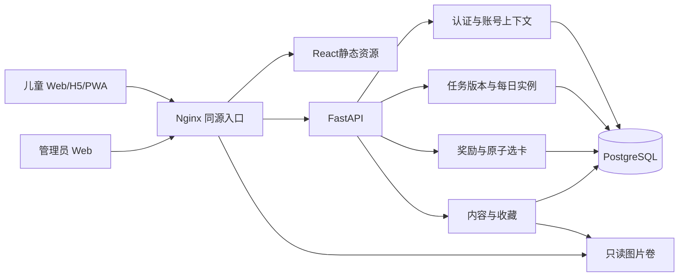

# 技术架构

## 选型

Python3.12、FastAPI、Pydantic、SQLAlchemy2同步Session、psycopg、PostgreSQL18、Alembic；React19、TypeScript、Vite、React Router、TanStack Query、Tailwind、Radix与shadcn风格基础组件。Python依赖使用uv.lock，前端使用package-lock.json，Node运行时24。

同步模块化单体足以覆盖家庭规模的事务操作。首版不引入Redis、Celery、微服务或通用Repository。每个请求独立Session，函数作用域依赖在发送响应前完成提交；业务写入由Service组织，异常统一回滚。

## 模块边界

| 模块 | 职责 |
|---|---|
| core | 配置、上海时间、错误、依赖和公开响应类型 |
| db | Session与关系模型 |
| auth | Cookie、CSRF、登录、会话成员与撤销 |
| tasks | 重复规则、版本、每日计划、完成与奖励触发 |
| rewards | 固定候选、选择、获得记录与收藏更新 |
| cards | 内容维护、图片规范化、图鉴与进度 |
| admin | 账号维护、业务记录、基础统计 |

前端app负责路由、布局与会话上下文，features负责页面，api负责请求与OpenAPI生成类型。服务端状态交给TanStack Query；当前账号保存在标签页sessionStorage中，仅存非敏感ID，不另引入全局状态库。

## 认证与多账号

儿童与管理员使用独立不透明Cookie；生产使用__Host-前缀、Secure、HttpOnly和SameSite=Lax。数据库保存SHA256随机凭证哈希。密码使用Argon2id。

GET /auth/csrf创建或读取会话并返回CSRF凭证。写操作要求精确Origin和X-CSRF-Token。成功登录轮换会话凭证并保留已认证儿童列表；儿童最多10个、固定30天；管理员最长8小时、空闲30分钟失效。五次失败触发15分钟限制，Nginx补充IP限流。

每个儿童业务请求携带X-Account-ID，必须匹配当前会话有效成员及凭证版本。重置密码或改变账号状态立即撤销成员资格。管理员身份不加入儿童列表。

所有儿童查询键均包含账号ID，请求闭包固定发送时账号；切换时取消旧查询并重建页面，旧响应不能覆盖新页面，退出账号移除其缓存。

## 事务和数据流

任务写操作：儿童行锁→准备今日实例→新增版本或改变完成状态→同步今日安排→判断奖励→提交。所有同一儿童的业务写入使用相同锁顺序。

选卡：儿童行锁→验证奖励与会话→验证选项属于会话→唯一获得记录→原子UPSERT收藏→推进状态→提交。异常回滚；重复请求读取原记录。

任务实例通过显式POST按需生成，GET业务查询不生成实例或发奖。历史缺失实例按不可变版本还原；未来仅预览。不需要零点生成任务的定时队列。认证最近访问时间与活跃日属于访问元数据。

## 部署与存储

本机开发连接用户提供的5432数据库，Vite5173代理API8000。Compose部署包含db、一次性migrate、api、web，数据库对主机默认5433；使用数据库与图片命名卷。PostgreSQL18数据卷挂载父目录/var/lib/postgresql。

开发Compose提供HTTP入口8080；生产覆盖文件提供HTTPS、HSTS及HTTP重定向。API与图片同源。图片存储服务目前写本地卷，将来可替换为对象存储；数据库仅记录资源键，不保存绝对磁盘路径。

图片仅管理员上传，最多5MB/1600万像素，检查真实JPEG/PNG/WebP格式，重新编码为WebP并移除EXIF。引用资源不提供删除接口。

PWA缓存公开静态资源和离线提示，不缓存账号API，不队列化离线打卡。未来Capacitor复用页面与请求层，通过单独认证适配器处理原生凭证，不把浏览器Cookie方案直接等同原生登录。

## 运维

API包含健康检查、请求ID与统一错误；不记录登录请求体或密码。备份暂停API，保存数据库与图片同一写入边界，并生成校验文件。恢复脚本只接受空目标。获得记录是事实来源，维护工具可重建收藏汇总。
