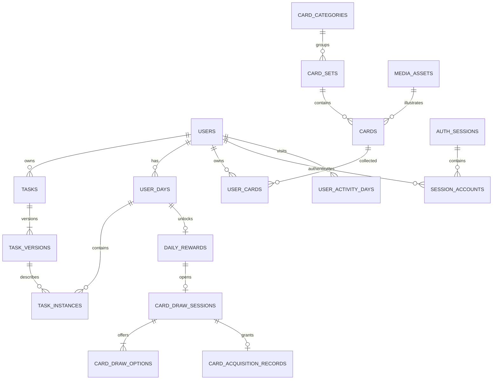

# PostgreSQL 数据库设计

本文字段表由 scripts/export_database.py 从实际模型生成；结构变更后重新生成。以Alembic迁移为结构事实来源。

## 约定

UUID主键由程序生成，事件时间为带时区时间，业务日期使用DATE。首版固定上海时区。外键默认限制破坏历史的删除；会话成员仅在删除会话时级联清理。所有业务表保存在同一应用schema。



## 核心状态与一致性

- 任务版本：active、paused、archived，修改新增版本；归档终止。
- 每日实例：is_included与completed_at分别表达是否参与和完成，不用任务表completed字段表示循环任务。
- 无奖励记录表示locked；奖励available→drawing→claimed，只向前。
- 抽卡会话open→claimed；获得记录唯一对应会话。
- daily_rewards.evidence保存解锁时total及tasks数组，含instance_id、version_id、name、completed_at。
- 候选与获得记录snapshot保存卡片当时资料和图片引用；user_cards是可重建汇总。

所有同一儿童业务写入先锁users行，再操作每日实例/奖励/选卡，最后提交。READ COMMITTED配合串行行锁和数据库唯一约束防止重复发放。

第二份迁移增加触发器：禁止修改/删除任务版本、候选和获得记录；禁止修改已解锁奖励依据或倒退状态；禁止修改过去日期实例。三候选数量、重复规则及当前日期资格由服务层验证。跨归属关系、选项归属、位置与权重范围由数据库约束。

## 实际字段、约束与索引

### auth_sessions

| 字段 | 类型 | 可空 | 主键 | 默认 |
|---|---|---|---|---|
| token_hash | VARCHAR(64) | 否 | 否 | — |
| csrf_hash | VARCHAR(64) | 否 | 否 | — |
| kind | VARCHAR(10) | 否 | 否 | — |
| expires_at | TIMESTAMP WITH TIME ZONE | 否 | 否 | — |
| last_seen_at | TIMESTAMP WITH TIME ZONE | 否 | 否 | — |
| id | UUID | 否 | 是 | 程序生成 |
| created_at | TIMESTAMP WITH TIME ZONE | 否 | 否 | now() |

- 唯一：token_hash
- 检查：`kind IN ('admin','child')`

```sql
CREATE INDEX ix_auth_sessions_expires_at ON auth_sessions (expires_at);
```

### card_categories

| 字段 | 类型 | 可空 | 主键 | 默认 |
|---|---|---|---|---|
| name | VARCHAR(60) | 否 | 否 | — |
| sort_order | INTEGER | 否 | 否 | 0 |
| status | VARCHAR(10) | 否 | 否 | active |
| id | UUID | 否 | 是 | 程序生成 |
| created_at | TIMESTAMP WITH TIME ZONE | 否 | 否 | now() |

- 检查：`status IN ('active','archived')`

### media_assets

| 字段 | 类型 | 可空 | 主键 | 默认 |
|---|---|---|---|---|
| storage_key | VARCHAR(200) | 否 | 否 | — |
| mime_type | VARCHAR(50) | 否 | 否 | — |
| width | INTEGER | 否 | 否 | — |
| height | INTEGER | 否 | 否 | — |
| size_bytes | INTEGER | 否 | 否 | — |
| id | UUID | 否 | 是 | 程序生成 |
| created_at | TIMESTAMP WITH TIME ZONE | 否 | 否 | now() |

- 唯一：storage_key

### users

| 字段 | 类型 | 可空 | 主键 | 默认 |
|---|---|---|---|---|
| username | VARCHAR(40) | 否 | 否 | — |
| password_hash | TEXT | 否 | 否 | — |
| display_name | VARCHAR(40) | 否 | 否 | — |
| avatar_key | VARCHAR(30) | 否 | 否 | fox |
| role | VARCHAR(10) | 否 | 否 | child |
| status | VARCHAR(10) | 否 | 否 | active |
| credential_version | INTEGER | 否 | 否 | 1 |
| failed_logins | INTEGER | 否 | 否 | 0 |
| locked_until | TIMESTAMP WITH TIME ZONE | 是 | 否 | — |
| id | UUID | 否 | 是 | 程序生成 |
| created_at | TIMESTAMP WITH TIME ZONE | 否 | 否 | now() |

- 检查：`role IN ('admin','child')`
- 检查：`status IN ('active','disabled')`

```sql
CREATE UNIQUE INDEX uq_users_username_lower ON users (lower(username));
```

### card_sets

| 字段 | 类型 | 可空 | 主键 | 默认 |
|---|---|---|---|---|
| category_id | UUID | 否 | 否 | — |
| name | VARCHAR(60) | 否 | 否 | — |
| description | VARCHAR(1000) | 否 | 否 |  |
| cover_asset_id | UUID | 是 | 否 | — |
| sort_order | INTEGER | 否 | 否 | 0 |
| status | VARCHAR(10) | 否 | 否 | active |
| id | UUID | 否 | 是 | 程序生成 |
| created_at | TIMESTAMP WITH TIME ZONE | 否 | 否 | now() |

- 外键：category_id → card_categories.id
- 外键：cover_asset_id → media_assets.id
- 检查：`status IN ('active','archived')`

```sql
CREATE INDEX ix_card_sets_category_id ON card_sets (category_id);
CREATE INDEX ix_card_sets_cover_asset_id ON card_sets (cover_asset_id);
```

### session_accounts

| 字段 | 类型 | 可空 | 主键 | 默认 |
|---|---|---|---|---|
| session_id | UUID | 否 | 是 | — |
| user_id | UUID | 否 | 是 | — |
| credential_version | INTEGER | 否 | 否 | — |
| authenticated_at | TIMESTAMP WITH TIME ZONE | 否 | 否 | — |

- 外键：session_id → auth_sessions.id
- 外键：user_id → users.id

```sql
CREATE INDEX ix_session_accounts_user_id ON session_accounts (user_id);
```

### tasks

| 字段 | 类型 | 可空 | 主键 | 默认 |
|---|---|---|---|---|
| user_id | UUID | 否 | 否 | — |
| id | UUID | 否 | 是 | 程序生成 |
| created_at | TIMESTAMP WITH TIME ZONE | 否 | 否 | now() |

- 唯一：id, user_id
- 外键：user_id → users.id

```sql
CREATE INDEX ix_tasks_user_id ON tasks (user_id);
```

### user_activity_days

| 字段 | 类型 | 可空 | 主键 | 默认 |
|---|---|---|---|---|
| user_id | UUID | 否 | 是 | — |
| business_date | DATE | 否 | 是 | — |
| first_seen_at | TIMESTAMP WITH TIME ZONE | 否 | 否 | — |
| last_seen_at | TIMESTAMP WITH TIME ZONE | 否 | 否 | — |

- 外键：user_id → users.id

### user_days

| 字段 | 类型 | 可空 | 主键 | 默认 |
|---|---|---|---|---|
| user_id | UUID | 否 | 否 | — |
| business_date | DATE | 否 | 否 | — |
| prepared_at | TIMESTAMP WITH TIME ZONE | 否 | 否 | — |
| revision | INTEGER | 否 | 否 | 1 |
| id | UUID | 否 | 是 | 程序生成 |
| created_at | TIMESTAMP WITH TIME ZONE | 否 | 否 | now() |

- 唯一：id, user_id
- 唯一：user_id, business_date
- 外键：user_id → users.id

```sql
CREATE INDEX ix_user_days_business_date ON user_days (business_date);
CREATE INDEX ix_user_days_user_id ON user_days (user_id);
```

### cards

| 字段 | 类型 | 可空 | 主键 | 默认 |
|---|---|---|---|---|
| set_id | UUID | 否 | 否 | — |
| name | VARCHAR(60) | 否 | 否 | — |
| description | VARCHAR(1000) | 否 | 否 |  |
| image_asset_id | UUID | 否 | 否 | — |
| rarity | VARCHAR(12) | 否 | 否 | common |
| draw_weight | INTEGER | 否 | 否 | 10 |
| sort_order | INTEGER | 否 | 否 | 0 |
| status | VARCHAR(10) | 否 | 否 | active |
| id | UUID | 否 | 是 | 程序生成 |
| created_at | TIMESTAMP WITH TIME ZONE | 否 | 否 | now() |

- 外键：image_asset_id → media_assets.id
- 外键：set_id → card_sets.id
- 检查：`draw_weight BETWEEN 1 AND 10000`
- 检查：`rarity IN ('common','rare','epic','legendary')`
- 检查：`status IN ('active','archived')`

```sql
CREATE INDEX ix_cards_image_asset_id ON cards (image_asset_id);
CREATE INDEX ix_cards_pool ON cards (status, set_id);
CREATE INDEX ix_cards_set_id ON cards (set_id);
```

### daily_rewards

| 字段 | 类型 | 可空 | 主键 | 默认 |
|---|---|---|---|---|
| day_id | UUID | 否 | 否 | — |
| user_id | UUID | 否 | 否 | — |
| state | VARCHAR(12) | 否 | 否 | available |
| earned_at | TIMESTAMP WITH TIME ZONE | 否 | 否 | — |
| evidence | JSONB | 否 | 否 | — |
| id | UUID | 否 | 是 | 程序生成 |
| created_at | TIMESTAMP WITH TIME ZONE | 否 | 否 | now() |

- 唯一：day_id
- 唯一：id, user_id
- 外键：day_id → user_days.id, user_id → user_days.user_id
- 外键：user_id → users.id
- 检查：`state IN ('available','drawing','claimed')`

```sql
CREATE INDEX ix_daily_rewards_user_id ON daily_rewards (user_id);
```

### task_versions

| 字段 | 类型 | 可空 | 主键 | 默认 |
|---|---|---|---|---|
| task_id | UUID | 否 | 否 | — |
| version_no | INTEGER | 否 | 否 | — |
| effective_date | DATE | 否 | 否 | — |
| name | VARCHAR(60) | 否 | 否 | — |
| description | VARCHAR(500) | 否 | 否 |  |
| icon | VARCHAR(30) | 否 | 否 | star |
| color | VARCHAR(20) | 否 | 否 | mint |
| sort_order | INTEGER | 否 | 否 | 0 |
| state | VARCHAR(10) | 否 | 否 | active |
| rule_type | VARCHAR(10) | 否 | 否 | — |
| start_date | DATE | 否 | 否 | — |
| end_date | DATE | 是 | 否 | — |
| planned_time | TIME WITHOUT TIME ZONE | 是 | 否 | — |
| weekdays | JSONB | 否 | 否 | 程序生成 |
| id | UUID | 否 | 是 | 程序生成 |
| created_at | TIMESTAMP WITH TIME ZONE | 否 | 否 | now() |

- 唯一：id, task_id
- 唯一：task_id, version_no
- 外键：task_id → tasks.id
- 检查：`end_date IS NULL OR end_date >= start_date`
- 检查：`rule_type IN ('once','daily','weekly')`
- 检查：`state IN ('active','paused','archived')`

```sql
CREATE INDEX ix_task_versions_effective ON task_versions (task_id, effective_date, version_no);
CREATE INDEX ix_task_versions_task_id ON task_versions (task_id);
```

### card_draw_sessions

| 字段 | 类型 | 可空 | 主键 | 默认 |
|---|---|---|---|---|
| reward_id | UUID | 否 | 否 | — |
| user_id | UUID | 否 | 否 | — |
| state | VARCHAR(10) | 否 | 否 | open |
| completed_at | TIMESTAMP WITH TIME ZONE | 是 | 否 | — |
| id | UUID | 否 | 是 | 程序生成 |
| created_at | TIMESTAMP WITH TIME ZONE | 否 | 否 | now() |

- 唯一：id, user_id
- 唯一：reward_id
- 外键：reward_id → daily_rewards.id, user_id → daily_rewards.user_id
- 外键：user_id → users.id
- 检查：`state IN ('open','claimed')`

```sql
CREATE INDEX ix_card_draw_sessions_user_id ON card_draw_sessions (user_id);
```

### task_instances

| 字段 | 类型 | 可空 | 主键 | 默认 |
|---|---|---|---|---|
| user_id | UUID | 否 | 否 | — |
| day_id | UUID | 否 | 否 | — |
| task_id | UUID | 否 | 否 | — |
| task_version_id | UUID | 否 | 否 | — |
| is_included | BOOLEAN | 否 | 否 | True |
| completed_at | TIMESTAMP WITH TIME ZONE | 是 | 否 | — |
| id | UUID | 否 | 是 | 程序生成 |
| created_at | TIMESTAMP WITH TIME ZONE | 否 | 否 | now() |

- 唯一：day_id, task_id
- 外键：day_id → user_days.id, user_id → user_days.user_id
- 外键：task_id → tasks.id, user_id → tasks.user_id
- 外键：task_version_id → task_versions.id, task_id → task_versions.task_id
- 外键：user_id → users.id

```sql
CREATE INDEX ix_task_instances_day_id ON task_instances (day_id);
CREATE INDEX ix_task_instances_task_id ON task_instances (task_id);
CREATE INDEX ix_task_instances_user_id ON task_instances (user_id);
```

### user_cards

| 字段 | 类型 | 可空 | 主键 | 默认 |
|---|---|---|---|---|
| user_id | UUID | 否 | 是 | — |
| card_id | UUID | 否 | 是 | — |
| quantity | INTEGER | 否 | 否 | — |
| first_acquired_at | TIMESTAMP WITH TIME ZONE | 否 | 否 | — |
| last_acquired_at | TIMESTAMP WITH TIME ZONE | 否 | 否 | — |

- 外键：card_id → cards.id
- 外键：user_id → users.id
- 检查：`quantity > 0`

```sql
CREATE INDEX ix_user_cards_card_id ON user_cards (card_id);
```

### card_draw_options

| 字段 | 类型 | 可空 | 主键 | 默认 |
|---|---|---|---|---|
| session_id | UUID | 否 | 否 | — |
| position | INTEGER | 否 | 否 | — |
| card_id | UUID | 否 | 否 | — |
| snapshot | JSONB | 否 | 否 | — |
| id | UUID | 否 | 是 | 程序生成 |
| created_at | TIMESTAMP WITH TIME ZONE | 否 | 否 | now() |

- 唯一：id, session_id, card_id
- 唯一：session_id, card_id
- 唯一：session_id, position
- 外键：card_id → cards.id
- 外键：session_id → card_draw_sessions.id
- 检查：`position BETWEEN 1 AND 3`

```sql
CREATE INDEX ix_card_draw_options_card_id ON card_draw_options (card_id);
CREATE INDEX ix_card_draw_options_session_id ON card_draw_options (session_id);
```

### card_acquisition_records

| 字段 | 类型 | 可空 | 主键 | 默认 |
|---|---|---|---|---|
| user_id | UUID | 否 | 否 | — |
| session_id | UUID | 否 | 否 | — |
| option_id | UUID | 否 | 否 | — |
| card_id | UUID | 否 | 否 | — |
| acquired_at | TIMESTAMP WITH TIME ZONE | 否 | 否 | — |
| snapshot | JSONB | 否 | 否 | — |
| id | UUID | 否 | 是 | 程序生成 |
| created_at | TIMESTAMP WITH TIME ZONE | 否 | 否 | now() |

- 唯一：session_id
- 外键：card_id → cards.id
- 外键：option_id → card_draw_options.id, session_id → card_draw_options.session_id, card_id → card_draw_options.card_id
- 外键：session_id → card_draw_sessions.id, user_id → card_draw_sessions.user_id
- 外键：user_id → users.id

```sql
CREATE INDEX ix_card_acquisition_records_acquired_at ON card_acquisition_records (acquired_at);
CREATE INDEX ix_card_acquisition_records_card_id ON card_acquisition_records (card_id);
CREATE INDEX ix_card_acquisition_records_user_id ON card_acquisition_records (user_id);
```

