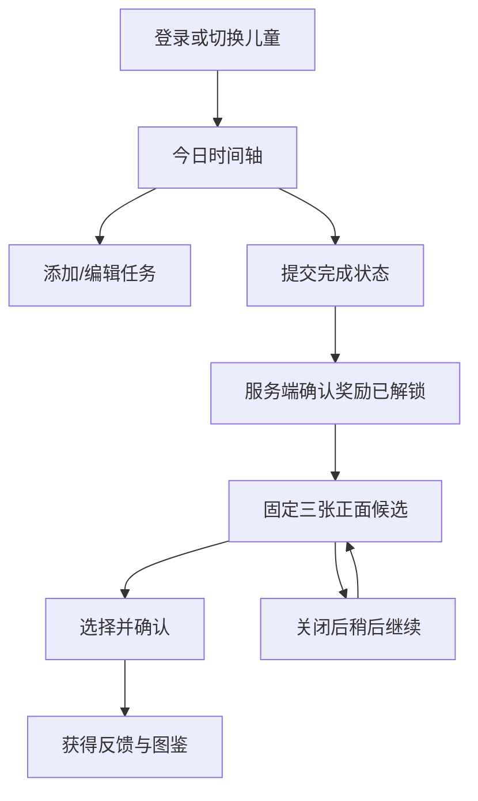

# 页面与交互

## 视觉方向

儿童端采用移动 App 风格：奶白底色、柔和紫色与奶油黄奖励条、大圆角卡片、自制小兔 SVG 伙伴。主要信息为今日任务和完成进度，减少宣传文案。主要操作有清晰文字或无障碍名称，不仅靠颜色传达状态。后台继续使用独立的鼠尾草绿管理界面。

## 儿童端

| 页面/入口 | 组件与行为 |
|---|---|
| 登录 | 账号密码、温和插画；管理员创建账号，无公开注册 |
| 头像切换 | 已认证儿童列表、添加账号、退出单个账号 |
| 今日 / | 紧凑日期标题、小兔进度卡、奖励状态条、任务筛选、添加与管理 |
| 任务 /tasks | 名称/说明、预设图标与颜色、规则、星期、起止日期、计划时间、排序；暂停、恢复、归档 |
| 日历 /calendar | 周一到周日任务表格：每个日期独立成列，在当天列内展示任务名称、图标、完成/未完成/待完成/已计划、时间、每日汇总与奖励；切换周、回本周，点击状态查看详情 |
| 奖励 /rewards | 按日期列出已保留的待领取奖励，不显示过期压力 |
| 三选一弹窗 | 正面展示固定候选、知识描述、显式确认；关闭后可恢复 |
| 图鉴 /collection | 卡片集进度、分类/系列/稀有度筛选、只看已收藏、数量与详情 |

手机使用单列任务，奖励条位于进度卡下方，今日／日历／图鉴／奖励四项底部导航始终可见。PAD 横屏与桌面（宽度至少 1000px）使用最大 1440px 的应用画布和悬浮导航；今日页左侧为进度与奖励，右侧为任务列表。较窄设备保留单列。周历表格根据宽度展示整周或允许局部横向滚动，没有固定任务名列，七列随日期一起滚动，同时提供左右滚动按钮和键盘滚动。图鉴宽屏五列、手机两列。手机弹窗使用底部面板，桌面居中。

任务名称可点击编辑，完成按钮为独立的 48px 触控区域。新建任务优先显示名称、图标、重复和日期时间；说明、颜色和排序收进“更多设置”。页面底部预留导航空间，适配安全区域；弹窗超出屏幕时可滚动。

当前账号头像和昵称常驻。切换会清空表单和选卡临时状态，不沿用上一儿童的操作。不同标签页可选不同儿童。

## 管理端

侧边导航：概览、儿童账号、卡片内容、抽卡记录。手机压缩为顶部导航，不复用儿童底部导航。

- 概览：六项指标、7/30天趋势、每日明细，空分母用“—”。
- 账号：搜索、状态筛选、创建/编辑、头像、禁用与密码重置，查看任务/收藏/抽卡记录。
- 内容：分类、卡片集、卡片三项管理；图片预览、所属关系、稀有度、权重、排序与归档。
- 抽卡记录：儿童、奖励日期与状态筛选，展示三候选及最终选项，单列实际领取时间。

## 交互状态

写操作等待服务端确认；按钮显示处理中并阻止重复点击。网络失败保持可重试，不显示虚假发卡成功。每个列表支持加载、空状态、错误和分页。

奖励状态独立于当前完成数：“奖励已解锁”允许与“当前2/3”同时存在。没有任务时显示添加目标，不显示可领取。

计划时间已过以中性文字提示，今天仍可打卡；过去详情只读。没有连续失败、倒计时或付费诱导。

## 可访问性与验证

Radix Dialog提供焦点管理、键盘关闭和屏幕阅读器标题。按钮提供可读名称，完成按钮使用checkbox语义；图鉴筛选使用aria-pressed；进度使用progressbar。触屏主要按钮至少48px，系统减少动画偏好关闭动画。

浏览器验收截图由Playwright保存在frontend/test-results，覆盖桌面今日、手机今日、三选一和后台。360、390、768、1440px 下检查无页面水平溢出。离线页面仅提示重新连接，不离线提交任务。
